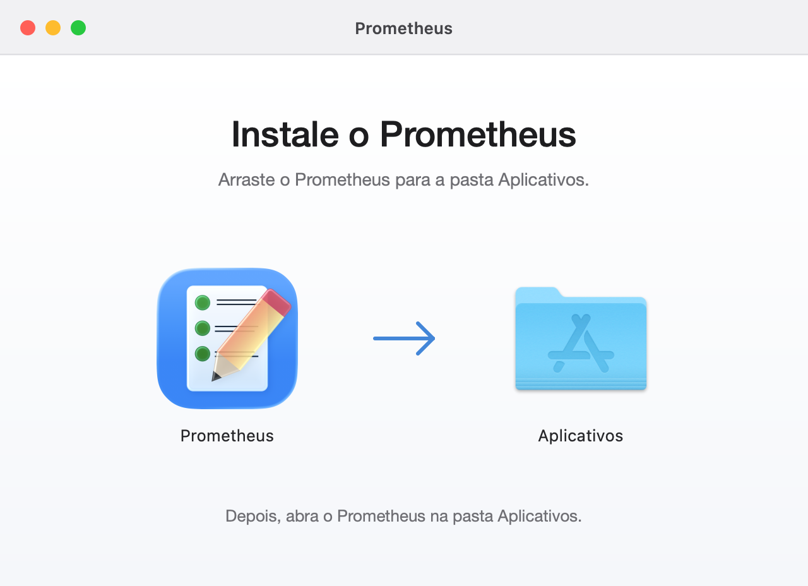

# Prometheus — Banco de Questões

Organize seu banco de questões e transforme seleções em provas e gabaritos
para Word. O Prometheus é um aplicativo de desktop em português brasileiro,
desenvolvido por **Pedro Trevisan**, com armazenamento local e funcionamento
offline, sem conta, servidor ou coleta de telemetria.

**Versão 2.0.0** · [Downloads e versões](https://github.com/pedrotrevis1/prometheus-banco-de-questoes/releases)
· [Novidades da versão](docs/releases/v2.0.0-notes.md)

## Download e requisitos

Baixe os aplicativos pela seção **Releases** deste repositório. Os arquivos
**Source code** disponibilizados pelo GitHub contêm o projeto, não o aplicativo
pronto para abrir.

| Plataforma | Pacote da versão 2.0.0 | Requisitos e situação |
|---|---|---|
| macOS | `Prometheus-2.0.0-mac-arm64.dmg` | Apple Silicon (`arm64`), macOS 15.0 ou posterior |
| Windows | `Prometheus.exe` — versão 2.0.0 | Windows de 64 bits (`x64`); compilado e validado localmente no Windows 11 |

**A versão Windows 2.0.0 está pronta e passou nas verificações locais.** O
executável está em `dist/Prometheus.exe`; sua publicação nos arquivos da release
no GitHub é uma etapa separada.

O DMG desta versão foi preparado com **assinatura ad-hoc, sem notarização da
Apple**. Esse pacote não atende a Macs Intel. O aplicativo compilado inclui
suas dependências; não é necessário instalar Python para utilizá-lo.

### Instalar no macOS

1. Baixe `Prometheus-2.0.0-mac-arm64.dmg` nos arquivos da release 2.0.0.
2. Abra o DMG e arraste **Prometheus** para o atalho **Aplicativos**.
3. Aguarde a cópia, ejete a imagem de disco e abra **Prometheus** em Aplicativos.
4. Confira a versão em **Menu → Sobre** e crie ou abra seu banco de questões.

Se o Gatekeeper bloquear a abertura, confira a origem do download e siga as
[orientações da Apple](https://support.apple.com/pt-br/102445). Para este pacote
sem notarização, pode ser necessário autorizar a abertura em **Ajustes do
Sistema → Privacidade e Segurança → Abrir Mesmo Assim**, após tentar abrir o
aplicativo.

Feche o Prometheus antes de substituir uma instalação existente. Atualizar o
aplicativo não transfere seus bancos de questões para outro computador.



*Prévia ilustrativa da instalação. A aparência dos ícones do sistema pode
variar conforme a versão do macOS.*

### Usar no Windows

1. Baixe `Prometheus.exe` nos arquivos da release quando estiver publicado.
2. Salve o arquivo em uma pasta de sua preferência e abra-o com dois cliques.
   O aplicativo é portátil: não exige instalador nem Python.
3. Confira **Menu → Sobre** e crie ou abra seu banco de questões.

Feche o aplicativo antes de substituir o executável por uma versão mais nova.
Seus bancos e backups são arquivos separados e devem ser preservados.

### Conferir o arquivo baixado

A release inclui `SHA256SUMS.txt`. Coloque-o na mesma pasta do DMG e execute
no Terminal, dentro dessa pasta:

```sh
shasum -a 256 -c SHA256SUMS.txt
```

O resultado esperado para o DMG é **OK**. O arquivo `macos-build-info.json`
registra versões das dependências e informações de verificação do build.

No Windows, compare o resultado abaixo com a linha de `Prometheus.exe` em
`SHA256SUMS-windows.txt`, disponibilizado junto com o executável:

```powershell
Get-FileHash .\Prometheus.exe -Algorithm SHA256
```

O arquivo `windows-build-info.json` registra os dados do build Windows.

## O que o Prometheus faz

- Mantém bancos independentes por disciplina, com categorias e subcategorias.
- Cadastra, edita e duplica questões de múltipla escolha e dissertativas.
- Organiza dificuldade, segmento, ano/série escolar, fonte e ano de origem.
- Permite texto formatado, imagens e marcações simples de equações.
- Busca enunciados, alternativas e respostas sem diferenciar maiúsculas ou
  acentos, com filtros e resultados paginados.
- Preserva a seleção entre páginas e permite escolher a ordem das questões.
- Salva provas com nome, turma e opções de geração, e registra o uso das questões.
- Gera arquivos `.docx` com versões numeradas, embaralhamento opcional e
  gabarito ao final ou em arquivo separado.
- Permite manter a ordem das alternativas de uma questão específica.
- Oferece temas claro e escuro, ajuda e backup pelo menu.

O **ano de origem** identifica quando a questão foi publicada ou aplicada;
ele é independente do **ano/série escolar** ao qual a questão se destina.

## Primeiros passos

1. Abra **Menu → Criar Novo Banco (Disciplina)** ou **Abrir Banco Existente (.db)**.
   Na primeira execução, a criação do banco padrão depende da sua confirmação.
2. Em **Cadastrar Questão**, preencha os dados, selecione categorias e anos/séries
   e informe o enunciado, alternativas ou resolução esperada.
3. Em **Buscar e Selecionar Questões**, aplique os filtros e marque as questões.
4. Em **Configurar e Gerar Prova**, ajuste turma, ordem, versões e gabarito;
   salve a prova para retomá-la e gere os arquivos Word.
5. Use **Nova prova** para começar outra seleção. O aplicativo pede confirmação
   antes de descartar alterações não salvas.

Abra os arquivos gerados no Microsoft Word ou em um editor compatível e confira
o conteúdo e a formatação antes de imprimir ou distribuir.

## Seus bancos e backups

Cada banco é um arquivo SQLite (`.db`) escolhido por você. Configurações e o
local padrão de dados ficam em:

| Sistema | Pasta |
|---|---|
| macOS | `~/Library/Application Support/GeradorProvasApp/` |
| Windows | `%USERPROFILE%\.gerador_provas_app\` |

O nome histórico da pasta no macOS é mantido para compatibilidade. Bancos
criados ou abertos em outros locais permanecem nesses locais.

**Antes de atualizar um banco antigo, mantenha uma cópia de segurança. Não
abra um banco atualizado em versões antigas do Prometheus:** elas podem não
exibir os dados novos corretamente. Leia os avisos de atualização e revise
os valores apontados no relatório de migração.

Use **Menu → Fazer backup** para criar uma cópia consistente do banco. Antes
de atualizar sua estrutura, o aplicativo cria um backup automático. São
mantidos até três backups automáticos por banco; a exclusão de um backup
antigo exige confirmação, e recusá-la cancela a atualização.

Para mudar de computador, copie o arquivo `.db` e abra-o no novo aplicativo.
**Copiar apenas o aplicativo não transfere as questões.** Remover uma
disciplina da lista não apaga o banco. Evite sincronizar um banco aberto por
serviços de nuvem e mantenha backups separados do arquivo de trabalho.

## Limitações e verificação

- Tabelas e listas coladas podem perder a estrutura na exportação. As marcações
  de equações não substituem um editor completo de equações do Word.
- Os arquivos de prova não incluem cabeçalho escolar; use o modelo da sua instituição.
- A escolha do tema não é lembrada entre sessões.
- A exclusão de questões atua sobre toda a seleção, inclusive questões ocultas
  por filtros ou por outra página. Revise a confirmação antes de excluir.
- O build macOS passou por **45 testes direcionados** e pela verificação de
  **13 arquivos Word** usando código compilado, além de verificações de
  assinatura, versão, recursos e layout do DMG.
- O build Windows passou por **429 testes** (um teste de permissão exclusivo
  de sistemas POSIX foi ignorado), **13 verificações de arquivos Word** com
  código compilado e abertura/fechamento nativos com perfis de teste isolados.
  Ícones, QR Code Pix, busca e provas salvas também foram verificados.
- A validação Windows foi realizada no Windows 11 x64. Instalação em outra
  máquina, comportamento após download e revisão visual no Microsoft Word
  ainda não foram verificados.
- Testes em instalação limpa, no macOS mínimo suportado, no Microsoft Word e
  a automação da janela nativa de salvar ainda estão pendentes. A tentativa de
  automação foi bloqueada pelas permissões de acessibilidade do macOS.

Os detalhes e os limites dessas verificações estão no
[relatório do pacote macOS](specs/017-macos-distribution/acceptance.md) e no
[relatório do executável Windows](specs/019-windows-distribution/acceptance.md).

## Executar o código-fonte

Requer **Python 3.14**. As dependências têm versões fixadas em
`requirements.txt` e `requirements-dev.txt`.

No macOS, dentro da pasta do projeto:

```sh
python3.14 -m venv .venv
source .venv/bin/activate
python -m pip install -r requirements.txt
python -m prometheus
```

No Windows, pelo PowerShell:

```powershell
python -m venv .venv
.\.venv\Scripts\Activate.ps1
python -m pip install -r requirements.txt
python -m prometheus
```

### Desenvolvimento e testes

Com o ambiente virtual ativo:

```sh
python -m pip install -r requirements-dev.txt
python -m pytest
```

O fluxo de contribuição é orientado por especificações: leia
[AGENTS.md](AGENTS.md), a [constituição](docs/constitution.md) e o
[roadmap](docs/roadmap.md) antes de alterar o projeto. Os testes de regressão
fazem parte do código-fonte e devem acompanhar as mudanças.

### Gerar aplicativos

No Mac de destino, com as dependências de desenvolvimento instaladas:

```sh
./build_macos.sh
./build_macos_dmg.sh
```

O primeiro comando gera `dist/Prometheus.app`; o segundo empacota esse app
existente no DMG. O empacotamento recusa substituir um DMG já existente.
Consulte os [detalhes do build macOS](packaging/macos/README.md) para informar
outro destino e para os requisitos de assinatura e aceitação.

No Windows, execute o script no próprio Windows:

```powershell
.\build_windows.ps1
```

O resultado é `dist/Prometheus.exe`. O executável Windows 2.0.0 já foi gerado
e passou nas verificações locais descritas acima. Cada novo build precisa ser
verificado antes da distribuição.

Se a política local do PowerShell impedir a execução do script, execute esta
alternativa na pasta do projeto, com o ambiente virtual ativo. Ela vale apenas
para esse processo e não altera a política permanente do computador:

```powershell
powershell.exe -NoProfile -ExecutionPolicy Bypass -File .\build_windows.ps1
```

## Preparar uma release no GitHub

Código-fonte, especificações e testes pertencem aos commits do repositório.
O executável Windows, o DMG e seus arquivos auxiliares devem ser anexados em **Releases**, como
arquivos da versão `v2.0.0`; `dist/` permanece ignorada pelo Git.

Veja o [guia de publicação](docs/releases/publishing.md) para a lista dos
arquivos locais a anexar e as verificações antes da publicação. As
[notas públicas da versão](docs/releases/v2.0.0-notes.md) estão prontas para
usar como descrição da release. A preparação local não publica a versão.

## Privacidade, responsabilidade e direitos

Os bancos e as configurações ficam no seu computador. O aplicativo não faz
requisições de rede nem coleta telemetria. Você controla os arquivos, seus
backups e qualquer compartilhamento realizado fora do aplicativo.

Revise questões, respostas, imagens e documentos antes de utilizá-los.
O conteúdo e seus direitos de uso são responsabilidade de quem o cadastra e
distribui; o aplicativo é uma ferramenta de apoio, sem garantia de ausência
de erros. Consulte o aviso em **Menu → Sobre**.

**Todos os direitos reservados.** A disponibilidade do código neste repositório
não concede licença de reutilização. Créditos e a opção de doação por Pix
estão em **Menu → Sobre**.
