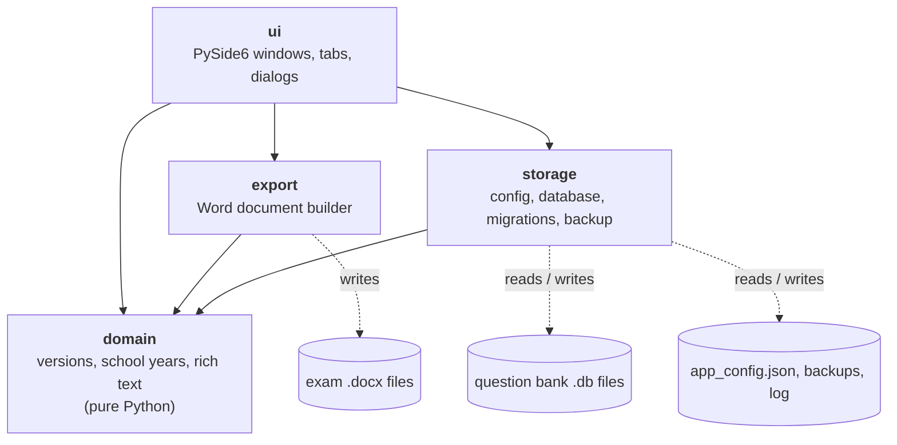

# Architecture

Last updated: 2026-11-14

## Current state (v1.1)

One file, `Prometheus1.1.py` (3,575 lines):

| Lines (approx.) | Content |
|---|---|
| 15–716 | Pix QR code image embedded as base64 |
| 731–982 | Constants, light/dark stylesheets, Windows theme overrides |
| 983–1133 | Custom icon engine and painted combo/spin boxes |
| 1135–1568 | Dialogs and widgets: `AddSubjectDialog`, `InsertEquationDialog`, `QuestionCard`, resize helpers, `AccessibleSelectionStyle` |
| 1570–3566 | `ExamGeneratorApp(QMainWindow)`: 63 methods covering UI construction, configuration file, database connection and migration, SQL queries, HTML clean-up, version shuffling and Word export |

Consequences: nothing is testable without a window; a change to storage or
export means editing the main window class; there are no tests, no dependency
file and no build script in the repository.

## Target state

```
prometheus/
  __init__.py        # __version__ (single source)
  __main__.py        # entry point: python -m prometheus
  domain/            # pure Python, no Qt, no I/O
    versions.py      # exam version generation and answer-key remapping
    school_years.py  # segment / year parsing and formatting
    richtext.py      # HTML fragment clean-up, equation markup
  storage/           # sqlite3 and files, no Qt
    config.py        # app_config.json and data directory
    database.py      # open/validate/close a bank, queries
    migrations.py    # ordered migrations keyed by PRAGMA user_version
    backup.py        # manual and automatic backups
  export/
    docx_exam.py     # builds the Word document from domain objects
  ui/                # PySide6 only; calls the layers above
    main_window.py, register_tab.py, search_tab.py, generate_tab.py,
    widgets.py, dialogs.py, theme.py
  assets/            # pix_qr.jpg and any future static files
tests/               # pytest, mirrors the package layout
```

Dependency rule: `ui → export, storage, domain`; `export → domain`;
`storage → domain`; `domain → nothing`. No layer imports `ui`.



Solid arrows are allowed imports; dotted arrows are file access. Only
`storage` and `export` touch the disk, and only `ui` imports PySide6 widgets.

## How we get there

Incrementally (strangler pattern), never by rewrite:

1. Spec 001 turns the file into the `prometheus` package, moves the UI as-is
   into one module and extracts only the already-pure functions.
2. From then on, constitution principle V applies: logic that a feature needs
   to change is first moved to `domain/`, `storage/` or `export/`, with tests,
   and only then changed.
3. The `ui/` split into several modules happens as tabs are touched by
   features 003–006. There is no dedicated "refactor everything" iteration.

## Decisions

| # | Decision | Reason |
|---|---|---|
| D1 | Keep PySide6, SQLite and python-docx | They work, fit the offline single-user product, and the owner knows them |
| D2 | One SQLite file per discipline stays | Files are the user's unit of backup and sharing (principle II) |
| D3 | Schema versioning via `PRAGMA user_version`, forward-only migrations | Built into SQLite, no dependency, replaces column sniffing in `migrate_db` |
| D4 | Backups via `sqlite3.Connection.backup()` | Produces a consistent copy even with an open connection |
| D5 | Raw `sqlite3` with a small repository module, no ORM | Simplicity (principle VI); the schema is small |
| D6 | Rich text stays stored as HTML, with a derived plain-text column for search (spec 005) | Avoids a risky content conversion while fixing search |
| D7 | Export keeps using `QTextDocument` to read stored HTML | It is the same parser that produced the content; tests run it with Qt's `offscreen` platform |

## Known risks

- **Qt in export tests.** `QTextDocument` needs a `QGuiApplication`; tests set
  `QT_QPA_PLATFORM=offscreen`. If this proves fragile in CI, the fallback is a
  small HTML parser in `domain/richtext.py`.
- **PyInstaller and assets.** Moving the QR image to a file requires bundling
  it (`--add-data`) and resolving its path through `sys._MEIPASS`.
- **Two UI code paths.** The code branches on `IS_WINDOWS` in 33 places; macOS
  behavior is at risk of regressing unnoticed until someone tests there.
