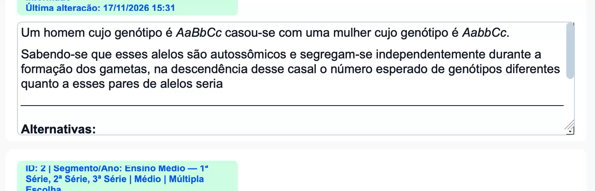
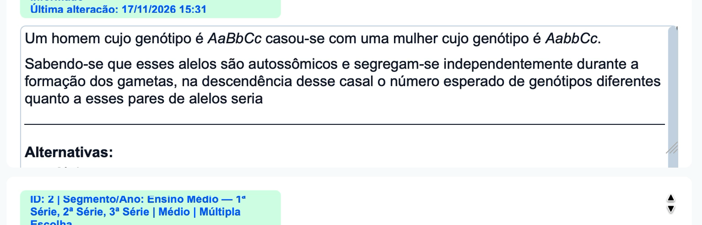

# Owner recording: preview changes internally but remains clipped

**Reported/reviewed**: 2026-11-18 | **Status**: Visual evidence reviewed;
current-source runtime reproduction and root cause pending
**Related**: [009 reproduction](../009-preview-resize/reproduction.md),
[spec](spec.md), baseline KD-20

## Evidence provenance

- Owner-provided file: `Gravação de Tela 2026-11-18 às 16.42.52.mov`.
- Original local path:
  `/Users/pedro/Desktop/Gravação de Tela 2026-11-18 às 16.42.52.mov`.
- SHA-256: `873cae261d736547c2e6c278cc384125315acdf3e024a12869ffe689d2f4efa4`.
- Duration: 8.9 seconds; encoded video dimensions: 1534 × 494 pixels.
- Reviewed frames sampled at one-second intervals. The two retained PNGs below
  are proportionally scaled to 1440 pixels wide; they are evidence images, not
  logical-pixel geometry measurements.
- Source inspected while preparing this handoff: Git revision `a1aa186`.
  The recording's app revision/build, Qt/Python versions, theme, scaling,
  full-window dimensions and preview mode are not established by the crop.
  The supplied recording is from the owner's macOS context; Windows behavior
  has not been verified for this symptom.

The original movie is referenced locally rather than added to the repository.
The retained frames allow another agent to inspect the symptom without access
to the owner's Desktop or question bank.

## Owner's steps

1. Open "Buscar e Selecionar Questões" with multiple question cards.
2. Use a long statement preview with an internal vertical scrollbar and the
   beginning of the next card visible below it.
3. Press the preview's lower-right resize handle.
4. Drag downward to enlarge the preview, then release.
5. Compare the visible reading area and the next card's starting position,
   rather than using the scrollbar alone as evidence of resizing.

## What the recording shows

| Time | Observation |
|---|---|
| Around 00:00 | The preview has a visible lower border and corner grip. The next card (ID 2) begins below it. The alternatives heading is at the bottom of the visible preview. |
| Around 00:02 | The preview's scrollbar thumb has lengthened and its lower border is no longer visible within the first card. The preview is cut off at the card boundary. The start of card 2 stays approximately where it was. |
| Around 00:04–00:06 | The enlarged internal preview remains cropped; no corresponding visible downward reflow of card 2 is apparent. |
| Around 00:08 | A later smaller preview again shows a lower border/grip; the next card still begins at approximately the same position. Exact button/release timing cannot be established from these sampled frames. |

Before the downward drag, around 00:00:

During the enlarged/clipped state, around 00:02:

Expected: an allowed increase produces more **visible** reading space; the
containing card grows and moves later cards downward by the same layout amount.
Observed: scrollbar changes suggest an internal geometry change, but the
containing visible card does not follow it. This is a visual observation, not
proof of which Qt widget, size hint or layout constraint causes the clipping.

## Why the previous checks do not close this report

009's reproduction records unbounded growth and automatic fitting overwriting
manual sizes. It does not record this clipped-child/stationary-card symptom.
`tests/ui/test_preview_resize.py` currently checks height caps and outer
stability. Its `test_card_reflow_moves_next_card_by_same_amount` compares
next-card displacement with card-height change but does not require either to
be positive or check that the preview remains visibly contained. Both can be
zero and satisfy that assertion. The large-drag cap assertion likewise does
not require a visible increase. These are coverage gaps, not a confirmed cause.

## Next agent's reproduction record

Use synthetic content and isolated configuration only. Record platform, app
revision/launch command, Python/Qt versions, theme, display scaling, window and
results-viewport size, preview mode, card count, header/usage rows and result
scroll position. Use at least two cards and a long multiple-choice preview to
match the visible case. Also test the existing essay fixture for comparison.

Record before/during/after/release/settled values for pointer Y, requested and
actual preview height, text viewport rectangle, preview/handle rectangles
mapped into the card, card contents rectangle/height, next-card top in result
content coordinates, result scrollbar value/range and outer UI geometry.
Measure visible intersections with ancestor clipping rectangles, not just the
preview's own `height()`. Save a visible before/after capture with synthetic
text. Until that is done, do not claim current-source reproduction or a fix.

## Current-source synthetic reproduction (2026-11-18)

Checkout `a1aa18648aa5f99853168dc6972c1c8055e00fa7`, macOS arm64,
Python 3.14.5, Qt 6.11.1, offscreen Qt platform, scale 1.0; synthetic
in-memory legacy-schema bank, three cards, 1250 × 850 window, 773 × 567
results viewport, scroll value 0. The executable in the owner's recording
remains unidentified; this establishes a current-source defect independently.
The test fixture was launched with `.venv/bin/python` and isolated temporary
configuration. No personal bank was opened. The result is an automated event
simulation, not native pointer or theme verification.

For a long multiple-choice statement with five alternatives, compact mode,
pointer displacements of 0, 20, 40 and 60 logical pixels produced:

| Displacement | Preview / text viewport height | Text viewport bottom in card | Handle top–bottom in card | Card height | Next card top | Results scroll value / maximum |
|---|---|---|---|---|---|---|
| 0 | 150 / 148 | 268 | 249–265 | 280 | 295 | 0 / 387 |
| 20 | 170 / 168 | 288 | 256–272 | 287 | 302 | 0 / 407 |
| 40 | 190 / 188 | 308 | 263–279 | 294 | 309 | 0 / 427 |
| 60 and settled after release | 210 / 208 | 328 | 269–285 | 300 | 315 | 0 / 447 |

The card contents rectangle was `(0, 0, 763, card height)`; the preview
viewport extended 28 pixels beyond the card after settling, overlapping the
handle. The next card moved only 20 pixels for a 60-pixel requested/actual
preview increase. The preview cap was 437 pixels (567 viewport less 130
chrome), so the drag had headroom. The handle's parent after insertion was
`QuestionCard`. An essay fixture also reproduced clipping (card grew 32 pixels
for a 60-pixel preview increase), as did a wrapped header with a synthetic
usage row (card grew 20 pixels). Results remained at scroll value 0. The
owner's recording revision and exact native conditions remain unknown.

The pre-fix regression `test_visible_preview_growth_and_shrink_reflow` fails in
both compact and expanded modes: compact card growth was 20 instead of 60;
expanded preview and handle overlapped. It asserts positive 60-pixel viewport,
card and next-card movement, containment, stable scrolling, inverse shrinkage
and unchanged content. The existing reflow check now requires positive growth.

## Layout investigation and fix

Before the fix, after the 60-pixel multiple-choice drag, the card's layout
minimum and size hint were 340 pixels while the actual card was 300 pixels;
the results content had grown, but the top-aligned layout allocated too little
space to the card. Explicitly invalidating the card and parent layouts did not
change the result. A minimum-size constraint on the card layout made the card
honor its minimum, but the next card still advanced only 20 pixels and could
overlap it. Replacing the top alignment with a separate stretch below the
results layout allows the layout to allocate each card its required height;
the card layout's minimum-size constraint protects its children. Both are Qt
layout adaptations; the domain sizing policy and its bounds are unchanged.
The compact and expanded regression now passes in both directions.

After the fix, the same multiple-choice fixture measured preview/text viewport
150/148 → 210/208, card 308 → 368, next-card top 323 → 383, and
handle bounds 277–293 → 337–353 in card coordinates. The preview viewport
bottom moved 268 → 328 and remained above the handle; scroll value stayed 0.
The same 60-pixel card/next-card increase occurred in the essay and wrapped
header/usage variants. Measurements settled after release; the automated
regression also verifies reverse movement.
